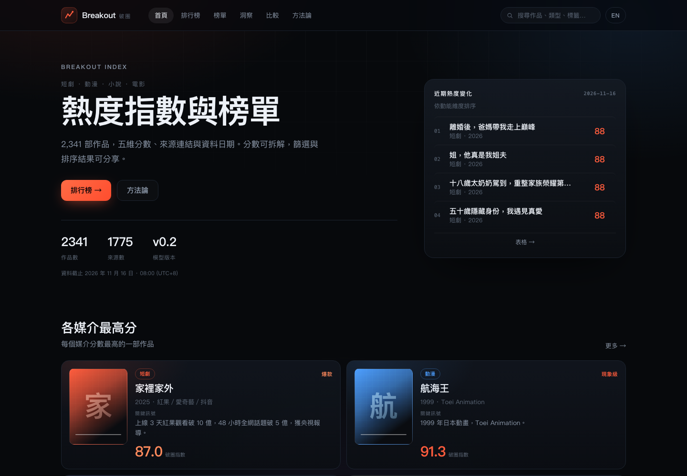
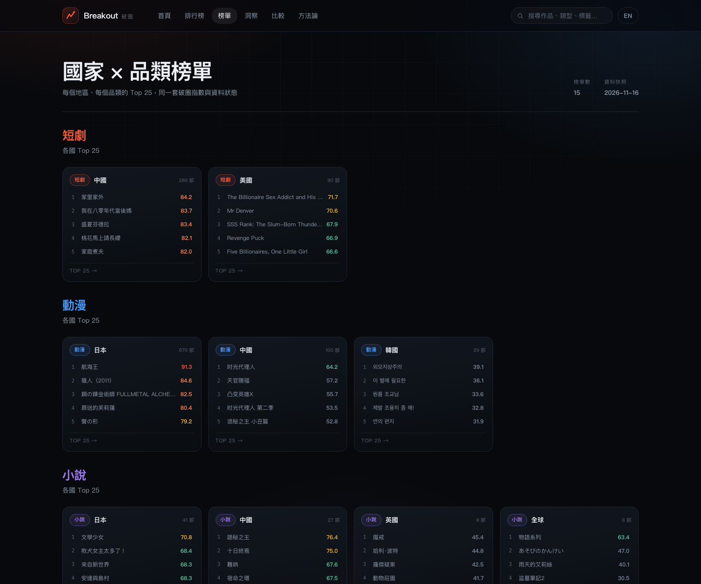
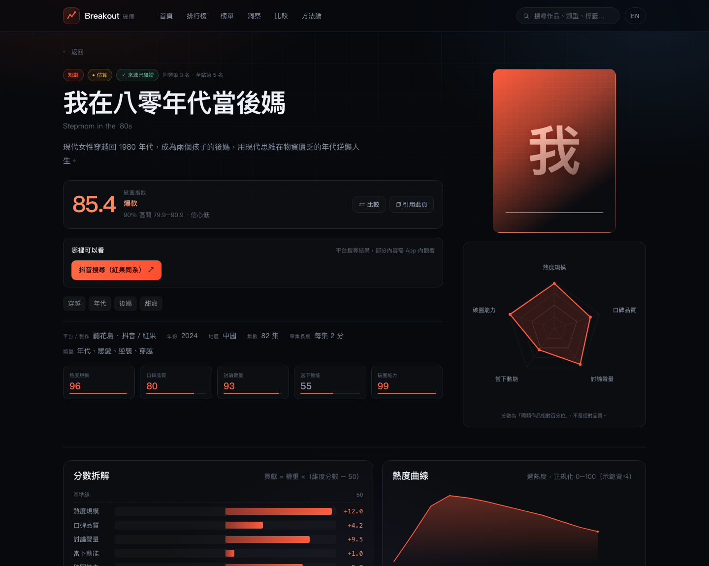

# Breakout 破圈

**用數據，看懂什麼值得看。** 短劇、動漫、小說、電影放在同一套可比較的爆款指數下。
*Know what is worth watching — short dramas, anime, novels and films scored on one comparable breakout index.*

[](../../actions/workflows/ci.yml)
[](../../actions/workflows/deploy.yml)
[](LICENSE)
[](LICENSE)

> 這是一個 **可公開研究的資料集 + 雙語推薦網站**：每個分數都能拆解，每個來源都能追溯。
> This is a **public research dataset + bilingual recommendation site**: every score decomposes, every source is traceable.

**Live demo / 線上展示：https://xworking88111-source.github.io/breakout/**



| 國家 × 品類榜單 / Country boards | 作品詳情＋去哪裡看 / Detail with watch links |
|---|---|
|  |  |

---

### 現況 / Status

| 項目 | 數值 |
|---|---|
| 收錄作品 | **2,341 部**：動漫 802、短劇 **1,359**（中國 1,322＋海外 37，皆已驗證）、小說 97、電影 83 |
| 模型 | **v0.2**（破圈維度正交化，crossover×reach 相關 −0.06） |
| 資料狀態 | 41.0%（959 部）measured、54.7%（1,160 部）estimated |
| 榜單 | 15 個「國家 × 品類」Top 25 |
| 資料集 | 3.9 MB／gzip 460 KB；計分 0.24 ms／2,341 部 |
| 更新 | 每日快照、每週回測、每週資料重建（全免費） |
| 廣告 | 版位已預留（首頁／榜單／詳情頁底部），**未啟用** |
| 顯示 | 全站字體 +2px、排行榜分頁（100 筆/頁）、作品頁「哪裡可以看」平台連結 |
| 譯名 | 非中文作品以 Wikipedia／Bangumi 補「最常見中文＋英文譯名」（覆蓋約 95%） |

---

## 中文

### 這是什麼

Breakout 把四種內容媒介放進同一把尺：短劇、動漫、小說、電影。
它不是另一個串流平台，也不是另一個豆瓣，而是「內容市場的資料終端」：

- **入口層**：今日焦點、正在爆、破圈榜、3 秒選片（心情 × 時長）
- **解釋層**：五維雷達、為什麼火瀑布圖、熱度曲線／評分分布、相似作品
- **信任層**：公式、權重、資料截止日、信心區間、來源、CSV 匯出、引用格式

### 核心特色

| 特色 | 說明 |
|---|---|
| 跨媒介同一把尺 | 五維 0–100 絕對刻度；短劇與動漫可直接比較相對位置 |
| 可解釋 | 破圈指數 = Σ（維度 × 權重），瀑布圖顯示每一維的邊際貢獻 |
| 誠實標記 | `measured`（公開 API 實測）／`estimated`（公開報導推估）永久可見 |
| 雙語 | 繁體中文 + English，作品名雙語、locale 感知數字 |
| 免費鏈路 | 托管、CI、排程、資料源全部使用免費方案（見下） |
| 可引用 | 每個作品頁可複製引用；資料集有版本號與快照日 |

### 快速開始

需求：Node.js ≥ 22、pnpm ≥ 9（或 npm）。不需要資料庫，MVP 資料是靜態 JSON。

```bash
# 前端 / frontend
cd app
pnpm install
pnpm dev          # http://localhost:5173
pnpm build        # 產出 app/dist

# 資料管線 / data pipeline（在 repo 根目錄）
node scripts/fetch_anilist.mjs     # 抓 AniList 公開資料
node scripts/build_dataset.mjs     # 正規化 + 計分 + 合併
node scripts/validate_dataset.mjs  # 驗證資料集
```

或使用根目錄腳本：`npm run data:all`、`npm run dev`、`npm run build`。

### 資料來源（全部免費）

| 來源 | 內容 | 認證 | 限制 |
|---|---|---|---|
| [AniList GraphQL](https://anilist.co) | 動漫評分、人氣、收藏、趨勢 | 免 key | 約 30–90 req/min |
| [Bangumi API v0](https://api.bgm.tv/v0) | 小說／電影評分、評分分布、收藏數 | 免 key（需 UA） | 每次搜尋最多 10 筆，以標籤批次累積 |
| 公開報導（36氪、央視、澎湃、DataEye 榜單報導等） | 短劇／小說／電影的編輯資料與佐證 | — | 逐筆標註連結 |
| 官方票房統計與維基百科 | 電影票房 | — | 公開資料 |

> 短劇與小說沒有免費且合規的官方 API。本站對這兩類採「公開報導推估 + 明確標記 estimated」，**不宣稱**擁有平台後台數據。詳見 [docs/03-數據源與合法性](docs/03-數據源與合法性.md)。

### 資料集與演算法

- 資料集：`app/public/data/works.json`（2,341 筆；3.9 MB / gzip 460 KB）
- 演算法：`scripts/build_dataset.mjs`（**v0.2**：五維加權 + 樣本收縮 + 錨點估算 SOP + 破圈正交化）
- 驗證器：`scripts/validate_dataset.mjs`（CI 會跑）
- 效能診斷：`node scripts/benchmark.mjs`（計分 0.24 ms／2,341 部；權重擾動 ρ = 0.992）
- 完整公式、權重、資料字典、估算 SOP、限制：[docs/02-量化評分機制](docs/02-量化評分機制.md)

### GitHub Pages 部署（免費）

1. 建立公開 repo 並 push（`main` 分支）。
2. **Settings → Pages → Build and deployment → Source: GitHub Actions**。
3. push 後 `deploy.yml` 會自動建置並部署到 `https://<user>.github.io/<repo>/`。
4. 若使用 `<user>.github.io` 根網域，把 `deploy.yml` 的 `BASE_PATH` 改成 `/`。

排程更新：`refresh-data.yml` 每週一自動重抓 AniList 並重建資料集（公開 repo 免費）。
**沒有任何金鑰、付費 API 或雲端服務。**

### 專案結構

```
app/                 Vite + React + TypeScript 前端
  src/views/         Home / Rankings / WorkDetail / Compare / Methodology
  src/components/    SVG 圖表、卡片、排版海報
  src/data/          anime.json（實測）、works.json（合併結果）
  src/i18n.ts        繁中／英文雙語字典
scripts/             抓取、計分、驗證
docs/                產品、產業、模型、資料源、UX、技術、決策
.github/workflows/   CI、Pages 部署、每週資料更新
```

### 文檔

| 文件 | 內容 |
|---|---|
| [00 產品定位與策略](docs/00-產品定位與策略.md) | 客群、差異化、如何超越 IMDb、商業模式 |
| [01 短劇產業與成癮機制](docs/01-短劇產業與成癮機制.md) | 紅果模式、市場數據、成癮四層、劇情 vs 投流 |
| [02 量化評分機制](docs/02-量化評分機制.md) | 公式、權重、資料字典、反刷分、v0.2 |
| [03 數據源與合法性](docs/03-數據源與合法性.md) | 綠／黃／紅燈、免費額度、ETL |
| [04 競品與 UX](docs/04-競品與UX資訊架構.md) | 競品拆解、簡潔化原則、雙語規範 |
| [05 技術架構與路線圖](docs/05-技術架構與路線圖.md) | 選型、資料模型、12 週路線圖 |
| [06 待拍板決策](docs/06-待拍板決策.md) | 需要你決定的 10 件事 |

### 授權

- 程式碼：MIT（見 [LICENSE](LICENSE)）
- 衍生資料：CC BY 4.0（請標註 Breakout 資料集與快照日）
- 上游資料（AniList 等）著作權屬原平台；商業使用前請自行確認條款
- 本站為原型，分數是相對熱度指數，不代表任何平台立場

### 貢獻

歡迎資料勘誤、翻譯、新資料源。請先讀 [CONTRIBUTING.md](CONTRIBUTING.md)。

---

## English

### What is this

Breakout puts four media types on one ruler: short dramas, anime, novels and films.
It is neither a streaming platform nor another review site — it is a **data terminal for the content market**:

- **Entry layer**: today's picks, breaking out now, breakout chart, 3-second picker (mood × duration)
- **Explanation layer**: five-dimension radar, "why it works" waterfall, heat curve / rating distribution, similar titles
- **Trust layer**: formula, weights, data cutoff, confidence intervals, sources, CSV export, citation

### Highlights

| Feature | Detail |
|---|---|
| One ruler across media | Five dimensions on an absolute 0–100 scale, so short drama and anime compare as relative positions |
| Explainable | Breakout Index = Σ (dimension × weight); the waterfall shows each dimension's marginal contribution |
| Honest labelling | `measured` (public API) and `estimated` (public reporting) are always visible |
| Bilingual | Traditional Chinese + English, bilingual titles, locale-aware number formatting |
| Free stack | Hosting, CI, scheduling and data sources all use free tiers (below) |
| Citable | Citation block on every title page; dataset has a version and snapshot date |

### Quick start

Requires Node.js ≥ 22 and pnpm ≥ 9 (or npm). No database — the MVP ships static JSON.

```bash
cd app
pnpm install
pnpm dev          # http://localhost:5173
pnpm build        # outputs app/dist

# from the repo root
node scripts/fetch_anilist.mjs
node scripts/build_dataset.mjs
node scripts/validate_dataset.mjs
```

### Data sources (all free)

| Source | Content | Auth | Limits |
|---|---|---|---|
| [AniList GraphQL](https://anilist.co) | Anime scores, popularity, favourites, trend | no key | ~30–90 req/min |
| [Bangumi API v0](https://api.bgm.tv/v0) | Novel / film ratings, distributions, collections | no key (UA required) | 10 rows per search; batched by tag |
| Public reporting (36Kr, CCTV, The Paper, DataEye coverage, etc.) | Editorial data and evidence for short dramas / novels / films | — | per-record links |
| Official box-office statistics and Wikipedia | Film box office | — | public data |

> Short dramas and novels have no free, compliant official API. Those records are **estimates from public reporting**, explicitly labelled `estimated`; the project does **not** claim platform-internal data. See [docs/03](docs/03-數據源與合法性.md).

### Dataset and algorithm

- Dataset: `app/public/data/works.json` (2,341 records; 3.9 MB / 460 KB gzipped)
- Algorithm: `scripts/build_dataset.mjs` (**v0.2**: five weighted dimensions + sample shrinkage + anchor-based estimation SOP + orthogonalised crossover)
- Validator: `scripts/validate_dataset.mjs` (run in CI)
- Benchmark: `node scripts/benchmark.mjs` (0.24 ms to score 2,341 works; weight-perturbation ρ = 0.992)
- Full formula, weights, data dictionary, estimation SOP and limitations: [docs/02](docs/02-量化評分機制.md)

### Deploy to GitHub Pages (free)

1. Create a public repo and push the `main` branch.
2. **Settings → Pages → Build and deployment → Source: GitHub Actions**.
3. `deploy.yml` builds and deploys to `https://<user>.github.io/<repo>/`.
4. For a `<user>.github.io` root site, set `BASE_PATH` to `/` in `deploy.yml`.

A weekly workflow (`refresh-data.yml`) re-fetches AniList and rebuilds the dataset — free for public repos.
**No API keys, no paid APIs, no cloud services.**

### Project layout

```
app/                 Vite + React + TypeScript frontend
  src/views/         Home / Rankings / WorkDetail / Compare / Methodology
  src/components/    SVG charts, cards, typographic posters
  src/data/          anime.json (measured), works.json (merged)
  src/i18n.ts        Traditional Chinese / English dictionary
scripts/             fetch, score, validate
docs/                product, industry, model, sources, UX, architecture, decisions
.github/workflows/   CI, Pages deploy, weekly data refresh
```

### Docs

| Document | Content |
|---|---|
| [00 Product & strategy](docs/00-產品定位與策略.md) | Audience, differentiation, beating IMDb, business model |
| [01 Short-drama industry & addiction mechanics](docs/01-短劇產業與成癮機制.md) | Hongguo model, market data, four addiction layers, plot vs. ad spend |
| [02 Scoring model](docs/02-量化評分機制.md) | Formula, weights, data dictionary, anti-gaming, v0.2 |
| [03 Data sources & legality](docs/03-數據源與合法性.md) | Green / yellow / red lists, free tiers, ETL |
| [04 Competitors & UX](docs/04-競品與UX資訊架構.md) | Competitive teardown, simplicity rules, bilingual conventions |
| [05 Architecture & roadmap](docs/05-技術架構與路線圖.md) | Stack, data model, 12-week roadmap |
| [06 Decisions needed](docs/06-待拍板決策.md) | Ten things to decide |

### Licence

- Code: MIT (see [LICENSE](LICENSE))
- Derived data: CC BY 4.0 (credit "Breakout dataset" and the snapshot date)
- Upstream data (AniList etc.) remains the property of the platforms; verify terms before commercial use
- Prototype only: scores are relative heat indices, not official data

### Contributing

Corrections, translations and new sources are welcome. Read [CONTRIBUTING.md](CONTRIBUTING.md) first.
